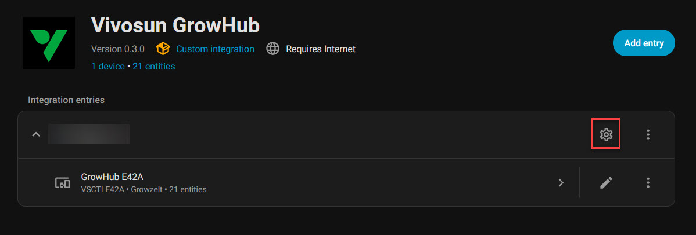
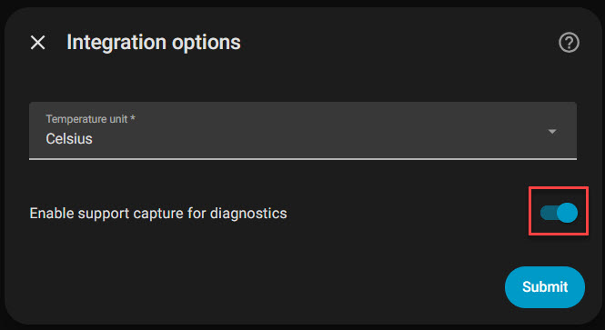
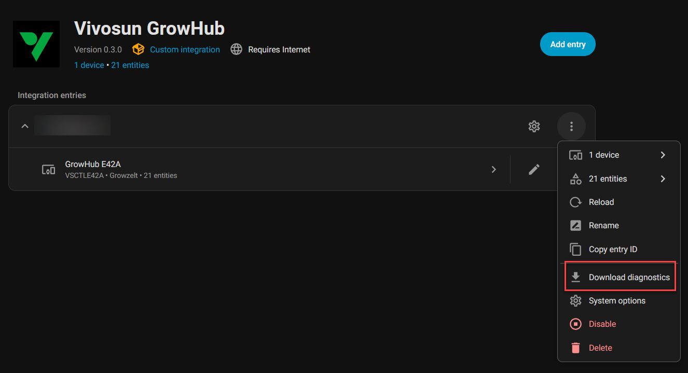

# Support capture checklist

Use this once and send back the resulting diagnostics JSON file.

## 1. Open the integration options

Go to **Settings → Devices & Services → Vivosun GrowHub**, then open the integration options with the cog button.

## 2. Enable support capture

Turn on **Enable support capture for diagnostics**, then submit.

Capture keeps device identifiers and telemetry, including text values. Credentials and recognized account, network and location fields are redacted.

Wait for the integration to finish reloading before continuing. Capture initializes separately. If the downloaded diagnostics still show a `capture_initializing` event without `capture_initialized`, allow the capture to finish and download again before submitting.

## 3. Exercise the device's controls

For camera discovery, missing camera, or duplicated-device reports, no device action is required. Wait for the integration reload to finish, then continue to step 4.

Open the target device in the **Vivosun app**. Try every relevant control it exposes:

- Turn power off and on.
- Change each adjustable level, speed, target, spectrum or other setting.
- Try each available mode and toggle options such as oscillation.
- Test timers, schedules, program selection and stage settings where available.
- Test controls for connected accessories too.

Change one setting at a time. Wait a few seconds and let the app show the new state before continuing.

If you are reporting a Home Assistant control problem, reproduce it in Home Assistant too.

## 4. Download diagnostics

Go back to the integration and use **Download diagnostics**.

Review the downloaded `config_entry-vivosun_growhub-*.json` file, then upload it to the issue or PR.

## 5. Turn support capture back off

Open the integration options again, disable **Enable support capture for diagnostics**, and save.

Once the issue is resolved, remove the uploaded diagnostics file from the issue or PR and any file-hosting service you used. Removing the upload does not remove copies others may already have made.
